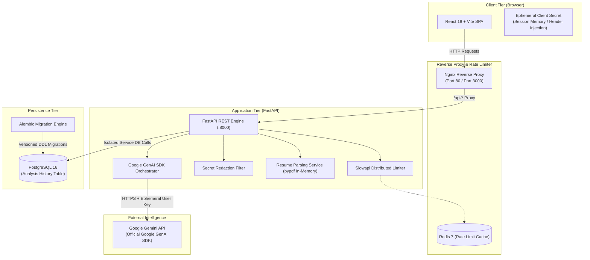

# AI Resume Reviewer Pro — System Architecture

This document details the architectural blueprint, component design, Bring Your Own Key (BYOK) security protocols, data persistence boundaries, and operational tradeoffs for **AI Resume Reviewer Pro**.

---

## 1. Architectural Overview

AI Resume Reviewer Pro is a decoupled, cloud-native web application built around strict zero-knowledge LLM credential security.

---

## 2. Component Breakdown

### 2.1 Frontend Tier (`/frontend`)
- **Runtime**: React 18, TypeScript, Vite.
- **Styling**: Tailwind CSS with custom branding tokens and responsive layout grids.
- **Routing**: React Router v6 managing `/`, `/dashboard`, and `/settings`.
- **API Client**: Axios instance configured with timeout budgets and base URL resolution.
- **Testing**: Vitest with `@testing-library/react` and `jsdom`.

### 2.2 Backend Application Tier (`/backend`)
- **Runtime**: Python 3.12+ ASGI served by Uvicorn.
- **Framework**: FastAPI with Pydantic v2 schemas and validation.
- **SDK**: Official `google-genai` Python SDK (`from google import genai`).
- **PDF Extraction**: `pypdf` in-memory stream processing (zero disk writes).
- **Abuse Prevention**: `slowapi` rate limiting backed by optional Redis or in-memory ring buffers.
- **Log Security**: `SecretMaskingFilter` scrubbing API key patterns and sensitive headers across all application loggers.

### 2.3 Persistence Tier (`PostgreSQL 16`)
- **ORM**: SQLAlchemy 2.0 with connection pooling (`pool_pre_ping=True`, `pool_size=10`, `max_overflow=20`).
- **Migrations**: Alembic versioning ensuring reproducible, auditable schema states without auto-modifying production databases on startup.
- **Data Boundary**: Isolated `AnalysisHistoryService` keeping database access strictly decoupled from HTTP route controllers.

---

## 3. Data Persistence Policy: What Is and Is Not Stored

| Data Category | Persisted to PostgreSQL? | Written to Disk? | Emitted in Logs? | Returned in Responses? |
| :--- | :---: | :---: | :---: | :---: |
| **User Gemini API Key** | **NEVER** | **NEVER** | **REDACTED** | **NEVER** |
| **Raw Uploaded Resume PDF** | **NEVER** | **NEVER** | **NEVER** | **NEVER** |
| **Extracted Resume Text / PII** | **NEVER** | **NEVER** | **NEVER** | **NEVER** |
| **Original Filename** | Yes (`analysis_history`) | No | Sanitized | Yes |
| **Target Role** | Yes (`analysis_history`) | No | Yes | Yes |
| **Evaluation Scores & Insights** | Yes (Optional in Phase 2) | No | No PII | Yes |

---

## 4. Gemini BYOK Security & Operator Access Limitations

### 4.1 Server-Side BYOK Security Model
1. **Request-Scoped Keys**: The user provides their Google Gemini API key via the `X-Gemini-API-Key` HTTP header.
2. **Ephemeral Lifecycle**: The key exists in memory strictly for the duration of the API call, is utilized by `genai.Client(api_key=key)`, and is immediately eligible for garbage collection.
3. **No Fallback Keys**: The server contains no master, shared, or developer fallback Gemini key. If the header is missing, the request is rejected with `401 Unauthorized`.
4. **Log Redaction**: A specialized logging filter strips any occurrence of Gemini key patterns (`AIza...`) and header tokens before logs are flushed.

### 4.2 Security Notice: Limitations of Server-Side BYOK
While server-side BYOK guarantees the application never *persists* user keys in databases, caches, or files:
- **Operator Access Risk**: The backend server operator technically has access to memory and network buffers while requests are being processed over TLS. An adversarial or compromised server environment could theoretically inspect request headers in flight.
- **Direct Browser Architecture Tradeoffs**:
  - For hyper-sensitive organizations, an alternative architecture allows the web browser to invoke Google's Gemini API directly.
  - *Tradeoffs*: Direct browser invocation exposes the user's API quota to browser extensions and client network inspection, bypasses centralized backend validation and rate limiting, and introduces CORS and API key management overhead on the client.
  - *Conclusion*: AI Resume Reviewer Pro implements hardened server-side BYOK with ephemeral memory handling, non-retention policies, and strict redaction filters as the optimal balance of user security, structured schema enforcement, and parsing reliability.

---

## 5. Model Selection Architecture

The application enforces a server-side allowlist of verified generally available (GA) Google Gemini models. Unrecognized or arbitrary model strings are rejected with `400 Bad Request`.

| Model Identifier | Display Name | Recommended | Context Window | Best Use Case |
| :--- | :--- | :---: | :---: | :--- |
| `gemini-2.5-flash` | Gemini 2.5 Flash | **Yes (Default)** | 1M tokens | Primary recommendation; ultra-fast structured JSON evaluation with high reasoning fidelity. |
| `gemini-2.0-flash` | Gemini 2.0 Flash | No | 1M tokens | Next-generation multimodal low-latency processing. |
| `gemini-1.5-flash` | Gemini 1.5 Flash | No | 1M tokens | High-volume parsing and rapid scoring. |
| `gemini-1.5-pro` | Gemini 1.5 Pro | No | 2M tokens | Deep analytical evaluation, career roadmaps, and multi-page dossiers. |

---

## 6. Rate Limiting and Abuse Prevention

- **Per-Endpoint Quotas**:
  - `GET /api/models`: Default quota (60 req/min).
  - `POST /api/keys/validate`: 20 req/min per IP.
  - `POST /api/analyze`: 10 req/min per IP (protecting compute and upload buffers).
- **Backend Storage**:
  - Multi-instance deployments use Redis (`REDIS_URL=redis://redis:6379/0`).
  - Single-instance local development falls back safely to in-memory tracking.
- **CORS Hardening**:
  - In production, wildcard `*` origins are strictly forbidden and logged as security alerts.
  - Permitted origins must match explicit trusted hostnames.

---

## 7. LinkedIn Profile Analyzer Architecture

The LinkedIn Profile Analyzer module adds role-benchmarking intelligence across personal LinkedIn profiles, supporting three distinct ingestion modalities and an evidence-based scoring engine:

### 7.1 Ingestion Modalities
1. **Mode 1: LinkedIn URL (`POST /api/linkedin/analyze-url`)**:
   - Strict syntax, domain, and path validation (`linkedin.com/in/<slug>`). Non-profile or external domains are rejected immediately.
   - Probes public URL without session cookies or illegal scraping techniques. If LinkedIn's authwall or anti-scraping walls (HTTP 999/403/login redirect) restrict member content, it analyzes available public metadata, computes partial coverage, explains the access limitation honestly, and prompts the user to use the PDF export for full analysis.
2. **Mode 2: Official LinkedIn PDF Export (`POST /api/linkedin/analyze-pdf`)**:
   - Validates official LinkedIn-generated "Save to PDF" documents in-memory.
   - Rejects encrypted, empty, non-PDF, or corrupted files with clear user feedback.
   - Provides 100% full coverage of private profile sections without risking account credentials.
3. **Mode 3: Fallback Pasted Text (`POST /api/linkedin/analyze-text`)**:
   - Allows users to paste raw profile text (headline, about, roles, skills) as an accessible alternative.

### 7.2 Scoring & Coverage Engine
- Evaluates 10 core standard profile sections (Headline, About, Experience, Skills, Education, Projects, Certifications, Keyword Optimization, Completeness, Target Role Alignment) with individual 0-100 scores.
- **Evidence-Based Scoring Rule**: Scores reflect only verifiable evidence present in the input. Inaccessible sections are marked as unavailable and excluded from quality scoring rather than unfairly penalized with a 0 score. Profile Completeness reflects overall presence of standard LinkedIn sections.
- **Target Role Alignment**: Benchmarks demonstrated competencies against user-selected roles (e.g. AI Developer, Data Analyst, Engineers) and produces a prioritized 30-day week-by-week action plan.

### 7.3 Data Segregation
- Analysis records are stored in `analysis_history` with `analysis_type="linkedin"` (distinguishing them from `analysis_type="resume"`).

