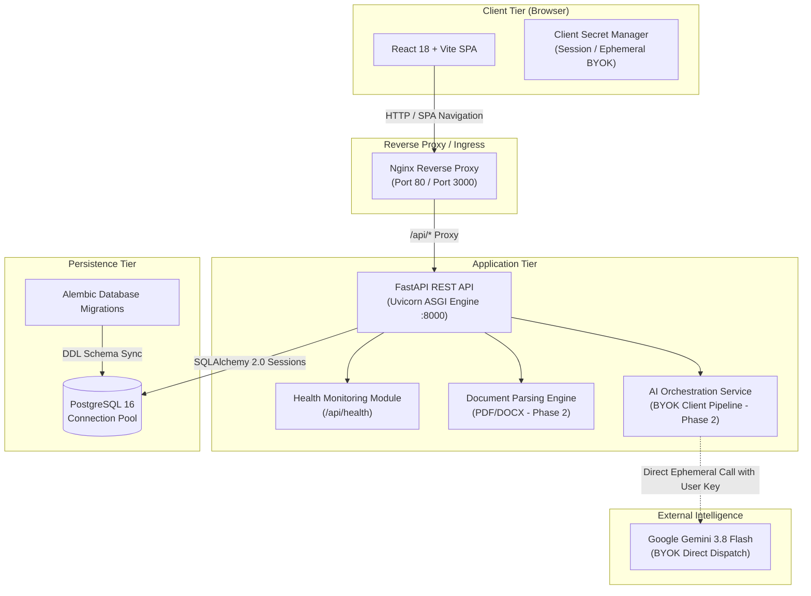

# AI Resume Reviewer Pro — System Architecture

This document outlines the architectural blueprint, design principles, component interactions, and security protocols for **AI Resume Reviewer Pro**.

---

## 1. Architectural Overview

AI Resume Reviewer Pro is structured as a decoupled, cloud-native web application adhering to modern clean architecture principles.

---

## 2. Component Breakdown

### 2.1 Frontend Tier (`/frontend`)
- **Framework**: React 18 with TypeScript and Vite for sub-millisecond HMR and optimized production bundles.
- **Styling**: Tailwind CSS with custom branding tokens and responsive layout grids.
- **State & Routing**: React Router v6 managing `/`, `/dashboard`, and `/settings`.
- **API Client**: Axios instance configured with centralized interceptors, timeout budgets, and base URL resolution.
- **Testing**: Vitest with `@testing-library/react` and `jsdom`.

### 2.2 Backend Application Tier (`/backend`)
- **Framework**: FastAPI with Python 3.12+ ASGI runtime served via Uvicorn.
- **Data Validation & Schemas**: Pydantic v2 schemas providing type safety and automated OpenAPI specification.
- **Settings Management**: Pydantic Settings loading environment configurations with validation rules and type coercion.
- **Separation of Concerns**:
  - `app/api/`: Routing layer and HTTP request/response serialization.
  - `app/core/`: Application settings, security definitions, and configuration.
  - `app/database/`: SQLAlchemy engine initialization and session management.
  - `app/models/`: SQLAlchemy 2.0 declarative database entities.
  - `app/schemas/`: Pydantic request/response transfer models.
  - `app/services/`: Core domain logic and third-party orchestration.
- **Testing**: Pytest with FastAPI `TestClient` and HTTPX asynchronous client fixtures.

### 2.3 Persistence Tier
- **Database**: PostgreSQL 16.
- **ORM**: SQLAlchemy 2.0 with connection pooling (`pool_pre_ping=True`, `pool_size=10`, `max_overflow=20`).
- **Migrations**: Alembic versioning ensuring idempotent, auditable schema evolutions.

---

## 3. BYOK (Bring Your Own Key) Security Architecture

A foundational tenet of AI Resume Reviewer Pro is zero-knowledge LLM credential storage:

1. **No Server Persistence**: The backend never writes Gemini API keys to PostgreSQL, disk, redis, or persistent application logs.
2. **Client-Controlled Credentials**: The user provides their Google Gemini API key via the settings interface or request header.
3. **Ephemeral Request Lifecyle**: During analysis requests (Phase 2), the key travels securely via TLS, is utilized strictly within the scope of the active request context, and is promptly garbage collected.
4. **Environment Isolation**: `.env.example` templates contain model identifiers only (`GEMINI_MODEL=gemini-3.8-flash`), strictly excluding server-side default keys.

---

## 4. Phase 1 Foundation vs. Future Roadmap

| Milestone | Scope & Capabilities |
| :--- | :--- |
| **Phase 1 (Current)** | Complete verified foundation: FastAPI, PostgreSQL configuration, Alembic, React SPA, Docker Compose orchestration, Health endpoint (`GET /api/health`), and CI/CD pipelines. |
| **Phase 2** | Resume upload (PDF/DOCX), document parser, Gemini 3.8 Flash BYOK analysis pipeline, ATS scoring heuristics, and career improvement recommendations. |
| **Phase 3** | User authentication, persistent review history, PDF report export, email notifications, and administrative dashboard. |
