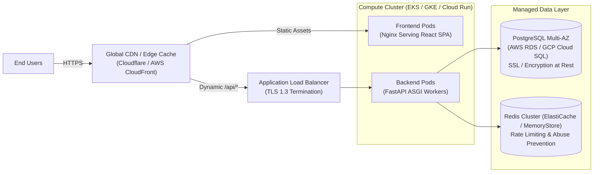
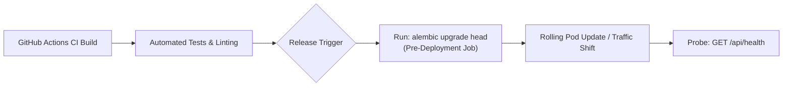

# AI Resume Reviewer Pro — Production Deployment Plan

This document details the production deployment architecture, security hardening standards, database migration pipelines, and operational monitoring.

---

## 1. Production Architecture Topology

---

## 2. Infrastructure & Service Hardening

### 2.1 Managed PostgreSQL 16
- **Storage Encryption**: KMS customer-managed key encryption at rest.
- **Network Isolation**: Accessible exclusively through private VPC subnets with strict security groups.
- **Connection Security**: Enforced TLS 1.3 (`sslmode=require`).
- **Connection Pooling**: Handled via PgBouncer or AWS RDS Proxy (`pool_pre_ping=True`, `pool_size=10`).
- **Automated Backup**: Multi-AZ standby replica with continuous archiving and 30-day point-in-time recovery (PITR).

### 2.2 Redis Rate Limiting & Abuse Protection
- **Multi-Instance Quotas**: Redis cluster tracking IP quotas for endpoints (`POST /api/analyze`, `POST /api/keys/validate`).
- **In-Memory Fallback**: If Redis connectivity degrades, Slowapi falls back gracefully to in-memory window buffers without halting application traffic.

### 2.3 Backend API Hardening
- **Zero Secrets Persistence**:
  - No master Gemini API keys are configured on backend servers.
  - Ephemeral user keys are processed exclusively in RAM during the active request lifecycle and immediately discarded.
- **CORS Protection**:
  - In production, wildcard CORS (`*`) is explicitly prohibited. Only registered frontend production domains are whitelisted.
- **Upload Restrictions**:
  - Max upload size is strictly capped at `MAX_UPLOAD_SIZE_MB=10`.
  - All uploads are inspected in-memory with magic byte verification (`%PDF-`) and structural parsing before passing to AI orchestration.

---

## 3. Database Migration Release Pipeline

Database schema migrations are managed through Alembic and must execute in an isolated pre-traffic deployment step:

1. **Pre-Traffic Execution**: Migrations run as a Kubernetes `Job` or release task before new application pods receive incoming traffic.
2. **Backward Compatibility**: Migrations must maintain backward compatibility with running pods during blue-green or rolling deployments.
3. **Rollback Procedure**: Each migration script contains an auditable `downgrade()` implementation for automated rollback if deployment verification fails.

---

## 4. Monitoring, Probes & Observability

- **Liveness & Readiness Probes**: Orchestrator probes `GET /api/health` every 10 seconds.
- **Secret Redaction in Logs**: `SecretMaskingFilter` ensures no Gemini API keys, authorization tokens, or sensitive headers are written to CloudWatch, Datadog, or Sentry.
- **Rate Limit Alerts**: Monitor 429 status response rates in Prometheus/Grafana to detect potential DDoS or abusive scraping patterns.
