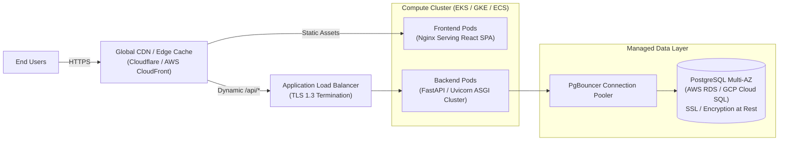

# AI Resume Reviewer Pro — Production Deployment Plan

This document details the production deployment strategy, cloud topology, security hardening, and operational standards.

---

## 1. Production Architecture Topology

---

## 2. Infrastructure Specification

### 2.1 Managed Database (PostgreSQL)
- **Engine**: PostgreSQL 16+ on managed service (AWS Aurora/RDS, Google Cloud SQL, or Neon).
- **Security**:
  - Encrypted at rest using customer-managed KMS keys.
  - Strict TLS requirement (`sslmode=require`).
  - Restricted to private VPC subnets with no public IP exposure.
- **Connection Management**:
  - Connection pooling handled via PgBouncer or AWS RDS Proxy.
- **Reliability**:
  - Multi-AZ replication with automated daily snapshots and 30-day point-in-time recovery (PITR).

### 2.2 Backend Application (FastAPI)
- **Packaging**: Container image built via multi-stage Dockerfile based on `python:3.12-slim`.
- **Runtime Configuration**:
  - Uvicorn workers configured according to CPU allocation: `(2 x $NUM_CORES) + 1`.
  - Memory bounds and restart policies enforced.
- **Secrets Management**:
  - Cloud secret managers (AWS Secrets Manager, GCP Secret Manager, or HashiCorp Vault) injected as runtime environment variables.
  - **Zero Key Storage**: No master Gemini key is configured on backend instances; user BYOK keys are received ephemerally in request headers.

### 2.3 Frontend Application (React SPA)
- **Distribution**: Static asset compilation deployed to Edge Storage (AWS S3 + CloudFront / Vercel / Cloudflare Pages).
- **Security Headers**:
  - Content-Security-Policy (CSP) restricting outbound connections.
  - Strict-Transport-Security (`HSTS` max-age=31536000).
  - `X-Frame-Options: DENY` and `X-Content-Type-Options: nosniff`.
- **Compression**: Brotli and Gzip pre-compression with immutable cache headers for hashed bundles (`/assets/*`).

---

## 3. CI/CD Deployment Pipeline

1. **Continuous Integration**:
   - Every pull request runs the complete CI matrix (`.github/workflows/ci.yml`):
     - Python 3.12 Pytest suite
     - Frontend ESLint, Prettier, and Vitest test suites
     - TypeScript compiler check (`tsc --noEmit`)
     - Docker image build verification
2. **Automated Migration Execution**:
   - Database migrations (`alembic upgrade head`) execute in an isolated pre-deployment job prior to traffic shifting.
3. **Zero-Downtime Rolling Deployment**:
   - Kubernetes rolling update or ECS Blue/Green deployment ensuring that new containers satisfy `/api/health` probes before retirement of legacy instances.

---

## 4. Monitoring, Logging, and Observability

- **Liveness & Readiness Probes**: Kubernetes or container orchestrator monitors `GET /api/health` every 10 seconds.
- **Structured JSON Logging**: Application logs emitted as structured JSON to stdout, ingested by Datadog / OpenTelemetry / CloudWatch.
- **Error Tracking**: Sentry configured for real-time unhandled exception telemetry on backend and frontend clients.
- **Uptime Alerts**: Synthetics querying `/api/health` with automated PagerDuty/Slack escalations.
